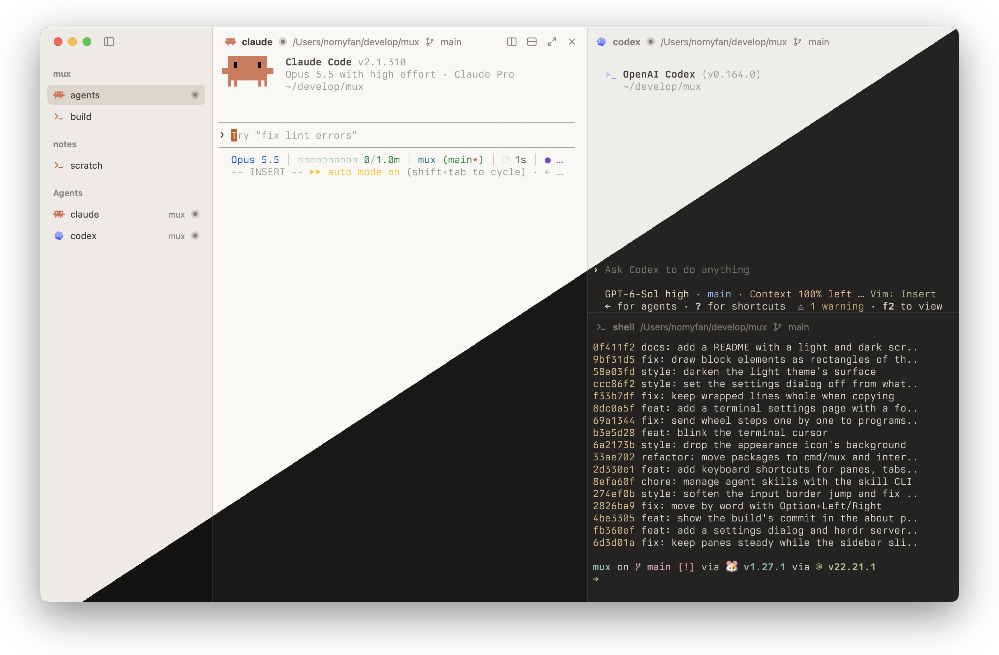

<p align="center">
  
</p>

<h1 align="center">Mux</h1>

<p align="center">A native GUI client for <a href="https://github.com/herdrdev/herdr-core">herdr-core</a> (<code>hc</code>), the terminal runtime for coding agents.</p>



```sh
curl -fsSL https://releases.herdr.dev/core/install.sh | sh   # install herdr-core, which Mux needs
go tool mygo dev     # run
go tool mygo build   # package into build/
```
